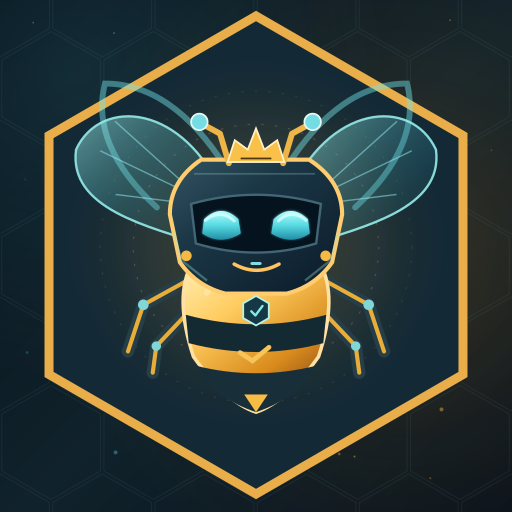
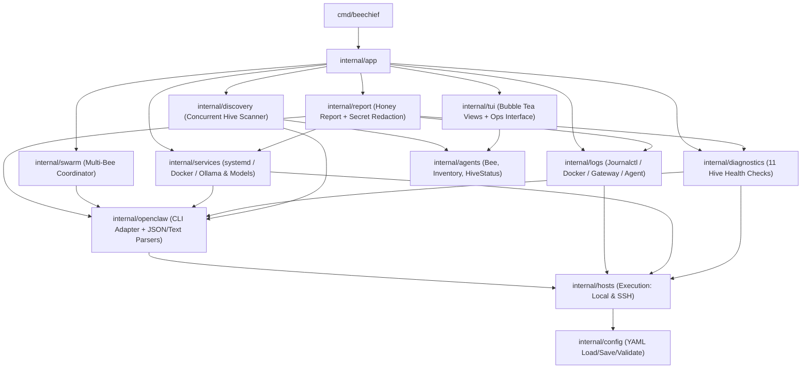

<p align="right">
  
</p>

# BeeChief architecture

This file explains how the code is laid out and why. Each layer depends only on the layers below it.

```text
cmd/beechief          entrypoint
internal/app          wiring: load/save config → build Scanner & Ops → start TUI or CLI diagnose
internal/tui          Bubble Tea UI; consumes Inventory and Ops interface without shell logic
internal/report       Honey Report diagnostic collector, Markdown renderer, and secret redaction
internal/swarm        bounded-concurrency multi-Bee self-review coordinator with cancellation
internal/logs         unified log browser adapters (journalctl, docker, openclaw, agent) + ANSI stripping
internal/services     capability-detected systemd, Docker, and Ollama/model troubleshooting
internal/diagnostics  read-only Hive Health quick diagnostic checks and severity sorting
internal/discovery    concurrent per-Hive scan, partial failure, rescan
internal/openclaw     the only package that knows the OpenClaw CLI (commands + JSON/text parsing)
internal/hosts        generic Execution: local and SSH, timeouts, structured errors
internal/config       YAML Hive configuration loader, validator, and round-trip mutation API
internal/agents       plain data models: Bee, Inventory, HiveStatus
```



## Design choices

**One execution interface.** `hosts.Execution` has a single method,
`Run(ctx, command, args...)`. Local and SSH Hives implement it the same way,
so everything above it works the same whatever the transport. Nothing in
`hosts` is specific to OpenClaw, so later diagnostics (systemd, Docker,
Ollama, network) can reuse it unchanged.

**Arguments are words, not shell strings.** Local execution calls the binary
directly with no shell. For SSH, OpenSSH always hands the remote command to
the remote shell, so each word is quoted with POSIX single quotes
(`hosts.ShellQuote`). Config validation rejects host and user values that
start with `-`, so they can't be read as ssh options. The argv also includes a
`--` before the host.

**System `ssh` instead of an embedded SSH library.** The operator's
`~/.ssh/config`, agent, keys, `ProxyJump`, and `known_hosts` all work without
BeeChief ever touching credentials. `BatchMode=yes` turns every interactive
prompt into a fast failure. `ConnectTimeout` bounds the connection handshake.
A context deadline (`DefaultTimeout` when the caller doesn't set one) plus
`exec.Cmd.WaitDelay` means `Run` always returns, even if a child process
keeps its pipes open.

**Errors vs results.** If a command ran and exited non-zero, `Run` returns a
`Result` with that `ExitCode` and a nil error. That lets callers interpret
exit codes in their own terms, for example 127 → OpenClaw not installed. If
the command could not run at all, `Run` returns a `*hosts.Error` with a
`Kind`: `unreachable`, `timeout`, `canceled`, `not_found`, or
`start_failed`. The error includes the Hive name, the command, and the
captured stderr. OpenSSH's own failure status, 255, maps to `unreachable`.

**OpenClaw isolated in one package, parsing in one file.** Only
`internal/openclaw` constructs OpenClaw commands (`agents list`, `skills list`,
`skills check`, `skills workshop list/show`, `agent --message`, `models status`,
`health`, `--version`). Only `internal/openclaw/parse.go` understands its JSON
and fallback text formats. The parser accepts bare arrays or wrapped objects,
ignores unknown fields, and skips banner lines before JSON, so a change in CLI
output means editing one file. Discovery and command failures use sentinel
errors (`ErrNotInstalled`, `ErrCommandFailed`, `ErrInvalidOutput`,
`ErrUnsupported`). Transport errors pass through as `*hosts.Error`, so
`errors.Is` and `hosts.IsKind` both work.

**Partial failure is normal.** `discovery.Scanner` scans Hives concurrently,
and each Hive gets its own timeout. Each outcome is written to
`agents.Inventory` as a `HiveStatus`, which is either OK or holds an error.
Healthy Hives always load, even when others fail. `Rescan()` rescans
everything; `Rescan(ctx, "hive")` refreshes only the named Hives and merges
the results into the last inventory. Bees are keyed as `hive/id`, so the
same agent ID on different Hives never collides. Similarly, `diagnostics.Run`
isolates each Hive Health check (including panic recovery), and
`swarm.Coordinator` isolates per-Bee review failures while preserving
completed reviews.

**Capability detection & safe-by-default operations.** `internal/diagnostics`
and `internal/services` probe whether optional subsystems (`systemd`, `Docker`,
`Ollama`) exist on a Hive before inspecting them, reporting absent tools as
`unavailable` rather than failing. All inspection is read-only; state-changing
systemd actions (`start`, `stop`, `restart`) require `confirmed == true` at the
API boundary (`services.ErrConfirmationRequired`) and an explicit `[y/N]`
confirmation in the TUI. Workshop proposals are never auto-applied.

**Structured diagnostics & redaction.** `internal/report` builds portable
**Honey Reports** directly from structured domain outputs (`Inventory`,
`HiveHealthReport`, `HiveServicesReport`, `SkillCheckSummary`, `WorkshopListReport`,
and `logs.Entry`) rather than scraping TUI strings, and passes the rendered
Markdown through `report.Redact` to strip tokens, passwords, authorization
headers, URL credentials, and PEM private keys.

**Configured vs discovered.** `config` only describes machines. No agent,
skill, or host name is hard-coded anywhere. Discovery produces every Bee. A
missing config file starts BeeChief with zero Hives. A malformed file, or one
with unknown keys, is an error, so mistakes and stray secrets don't go
unnoticed. `config.Save` validates before writing and preserves existing file
permissions.

**UI knows nothing about operations.** The TUI receives a `ScanFunc` and a
`tui.Ops` interface, rendering the resulting domain structs. Scans, skill
checks, self-reviews, service inspections, log fetches, and exports run as
async `tea.Cmd`s so the UI never blocks on network or subprocess I/O.
