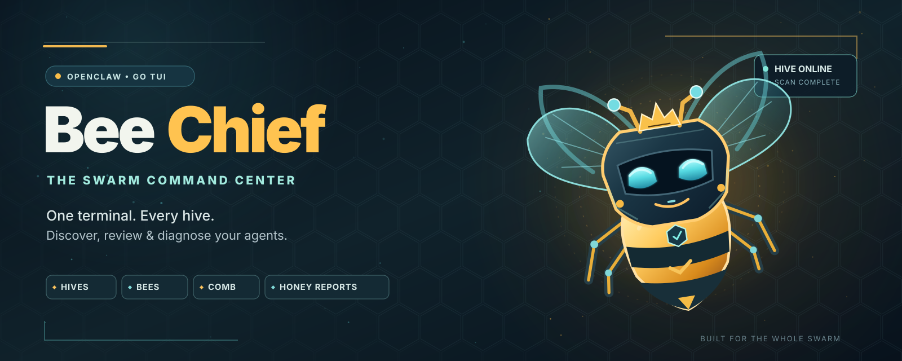

<p align="center">
  
</p>

# BeeChief 🐝

**The Swarm Command Center** — *One terminal. Every hive. Discover, review & diagnose your agents.*

A Go terminal and browser control center for managing, reviewing, diagnosing, and maintaining OpenClaw agents across multiple machines.

BeeChief treats machines as **Hives**, OpenClaw agents as **Bees**, and skills as the **Comb**. Hosts are configured; agents, skills, and capabilities are discovered dynamically.

## Core idea

```text
Hive Scan → discover Bees → inspect Comb → self-review → troubleshoot → Honey Report
```

Nothing agent-specific should be hard-coded.

## Quick start

### Install or update via script (Linux / macOS / Windows)

```bash
# Linux / macOS (release binary or local --from-source build)
./scripts/install.sh --from-source

# Cross-platform release archives (Linux, Windows, macOS)
make release
```

The Linux/macOS shell installer verifies release archives against `SHA256SUMS.txt` and refuses unverified downloads. On Windows PowerShell:

```powershell
powershell -ExecutionPolicy Bypass -File .\scripts\install.ps1 -FromSource
```

### Run from source

```bash
go build ./...
mkdir -p ~/.config/beechief
cp configs/hosts.example.yaml ~/.config/beechief/hosts.yaml   # then edit
go run ./cmd/beechief
```

With no config file BeeChief still starts, with zero Hives, and you can add local or SSH Hives interactively from **Settings**. Set `BEECHIEF_CONFIG=/path/to/hosts.yaml` to use a different file, or `NO_COLOR=1` for high-contrast plain-text accessibility mode.

To generate and export a portable, secret-redacted **Honey Report** from the CLI:

```bash
go run ./cmd/beechief diagnose --export --output honey-report.md
```

Keys: `↑/↓` (or `k/j`) move · `enter` select · `/` filter/search · `r` rescan all Hives · `esc` back/quit · `q` quit.

## Web UI

Run the browser mode on the machine that hosts BeeChief:

```bash
beechief web                 # http://127.0.0.1:8080
beechief web --addr 127.0.0.1:9090
beechief web --read-only     # diagnostics and inspection only
```

The web UI covers Swarm Overview and scanning, per-Bee skills/checks/self-review/Workshop/models/instructions, Hive Health and services, the unified log browser, Honey Report export, Hive configuration, and cron job management.

It binds to loopback by default. Binding a non-loopback address requires `--allow-remote` and is not authenticated beyond a per-process API/CSRF token, so keep it behind a private network or reverse proxy with its own auth. `--read-only` disables config edits, service control, instructions, job runs, and background scheduling.

## Automation & cron

Non-interactive commands are available for external schedulers:

```bash
beechief scan --json                  # exit non-zero if a Hive fails
beechief scan --allow-failures        # tolerate partial scans
beechief health --json --fail-on fail # fail on failed checks
beechief health --hive basement --fail-on warning
beechief diagnose --export -o honey-report.md
```

BeeChief also includes a five-field cron scheduler for `scan`, `health`, and `report` jobs; schedules use the process local time. Copy [`configs/jobs.example.yaml`](configs/jobs.example.yaml) to `~/.config/beechief/jobs.yaml` and run:

```bash
beechief cron                         # long-running scheduler
beechief cron --file /path/jobs.yaml  # alternate jobs file
beechief cron --once                  # run every enabled job once
```

| Job field | Required | Notes |
|---|---|---|
| `name` | yes | Unique job identifier. |
| `kind` | yes | `scan`, `health`, or `report`. |
| `schedule` | yes | Five-field cron expression (`minute hour day-of-month month day-of-week`). |
| `hive` | no | Target Hive for `health`/`report`; empty means all configured Hives. |
| `output` | no | Honey Report path for `report` jobs. |
| `disabled` | no | Skip the job without deleting it. |

The web UI can add, edit, run, and delete jobs. External cron equivalents are:

```cron
0 3 * * *   /usr/local/bin/beechief scan --json >> /var/log/beechief-scan.log 2>&1
0 * * * *   /usr/local/bin/beechief health --fail-on fail
0 6 * * 1   /usr/local/bin/beechief diagnose --export -o /srv/reports/honey-$(date +\%F).md
```

## Configuring Hives

Only machines are configured. Agents are never listed in config. Configuration files use schema `version: 1` (legacy v0 files and `hosts:`/`hostname:`/`username:` aliases are migrated automatically on load and upgraded on save).

```yaml
version: 1

hives:
  - name: work-pc
    type: local

  - name: qmu
    type: ssh
    host: qmu-server   # hostname, IP, or ~/.ssh/config alias
    user: root         # optional
    # port: 22         # optional
    # label: Basement  # optional
    # controlMaster: true    # optional (default true on Unix; reuses SSH master socket)
    # controlPersist: 60s    # optional
```

| Field   | Required  | Notes |
|---------|-----------|-------|
| `version` | no      | Schema version (`1`). Legacy `0`/omitted configs migrate automatically; newer unknown versions fail safely. |
| `name`  | yes       | Unique Hive identifier shown in the UI. |
| `type`  | no        | `local` or `ssh`. If you leave it out, an empty `host` (or `host: local`) means local; anything else means ssh. |
| `host`  | for ssh   | Passed to the system `ssh` client as-is. |
| `user`  | no        | `ssh -l`. |
| `port`  | no        | `ssh -p`. |
| `label` | no        | Free-text description. |
| `controlMaster` | no | Enable OpenSSH `ControlMaster=auto` connection reuse (default `true` on Linux/macOS). |
| `controlPersist` | no | Idle duration for multiplexed SSH master sockets (default `60s`). |

Unknown keys are rejected, so a typo (or a stray `password:`) fails loudly.

**SSH and credentials.** BeeChief uses your system `ssh` client, so your
`~/.ssh/config`, ssh-agent, keys, `ProxyJump`, and `known_hosts` all apply.
It runs with `BatchMode=yes` and a connect timeout: a host that would ask for
a password or a host-key confirmation fails right away with a clear error
instead of hanging. No passwords or keys go in BeeChief's config or source.

## Agent discovery

On startup, and whenever you press `r`, BeeChief runs this on every Hive
concurrently:

```bash
openclaw agents list --json
```

It records each agent's ID, display name, emoji, model, workspace, agent
directory, and default flag, along with the Hive the agent was found on. Agents
are grouped by Hive, so the same agent ID on two Hives never collides. Each Hive
is scanned on its own with its own timeout. If a Hive fails (unreachable,
timeout, OpenClaw not installed, command failed, or output that is not valid
JSON), it is marked with `✗` and the error, and the other Hives still load.

On SSH Hives, `openclaw` must be on the `PATH` of a *non-interactive* login
shell. If it is installed in a user-local directory, add that directory to
`PATH` in a file that non-interactive shells read (e.g. `~/.bashrc` above any
interactive-only guard, or `~/.ssh/environment` where it is enabled).

## Features & Workflows

### Swarm Overview & Bee Detail (`#4`, `v0.5`)
- View total Hive count, total Bee count, per-Hive online/offline state, and last scan time.
- Filter discovered Bees interactively with `/`, supporting multi-token boolean AND queries, negation (`!token` / `-token`), and field-scoped selectors (`hive:`, `model:`, `id:`, `name:`, `status:online`/`status:offline`, `default:true`).
- Large swarms automatically window/paginate lists cleanly to fit any terminal height (`[showing X–Y of N]`).
- Select any Bee (`enter`) to inspect its status, visible skills, skill check, self-review, Workshop proposals, curator/learning status, model status, or send a custom instruction.

### Comb / Skills Inspection (`#5`, `v0.5`)
- Wraps `openclaw skills list --agent <id> --json` and `openclaw skills check --agent <id> --json`, with automatic fallback to plain-text CLI output on older OpenClaw versions that lack `--json`.
- Highlights ready/loadable skills vs. broken or missing-requirement skills (`bins`, `anyBins`, `env`, `config`, `os`), and supports interactive `/` skill filtering.
- Surfaces unsupported OpenClaw CLI versions clearly and allows toggling raw CLI output (`v`) for troubleshooting.

### Self-Review, Workshop Proposals & Swarm Review (`#6`, `#10`)
- Runs a structured 7-point skill self-review on a selected Bee (`s`) and lists resulting Skill Workshop proposals (`w`) and proposal Markdown content (`enter`).
- **Safety by default**: Workshop proposals are strictly read-only in BeeChief and are never silently auto-applied.
- **Swarm Review**: Run self-review across the selected Bee (`1`), all Bees on the selected Hive (`2`), or all Bees across all reachable Hives (`3`) with bounded concurrency, live per-Bee state (`queued` / `running` / `complete` / `failed` / `skipped`), proposal count rollups, and safe cancellation (`x`) that preserves completed results.

### Hive Health & Subsystem Troubleshooting (`#7`, `#8`)
- **Hive Health (`Troubleshooting`)**: Runs 11 read-only checks (reachability, OpenClaw CLI version, Gateway health, agent discovery, disk free space, RAM, swap, model providers, Docker, systemd, and recent service failures) with severity sorting (`s`).
- **Services (`Services`)**: Capability-detected inspection for **systemd** units (status, enabled state, recent logs, plus `S`/`T`/`R` start/stop/restart gated behind an explicit `[y/N]` confirmation prompt), **Docker** containers (state, ports, non-streaming CPU/RAM stats, recent logs), and **Models & Ollama** (detects mismatches between OpenClaw's configured models and reachable providers/local Ollama models).

### Unified Log Browser & Event Persistence (`#9`, `v0.5`)
- Browse bounded tails across `journalctl`, `docker`, `openclaw` Gateway logs, `agent` status output, and persistent BeeChief `events` on any Hive.
- Operational events (scans, skill checks, self-reviews, Swarm Reviews, custom instructions, Hive Health passes, systemd actions, Honey Report exports, config saves) are automatically redacted of secrets and persisted to a size-rotated JSONL log (`~/.config/beechief/events.jsonl`).
- Filter by errors-only (`e`), warnings+errors (`w`), or text search (`/`).
- Toggle non-blocking follow mode (`f`) and inspect the exact underlying CLI command (`c`). All remote output is stripped of ANSI/control sequences.

### Honey Report Diagnostics (`#11`)
- Export a portable Markdown diagnostic report from the TUI (`e` in Swarm Overview or Troubleshooting) or from the CLI:
  ```bash
  beechief diagnose --export --output honey-report.md
  ```
- Includes BeeChief & OpenClaw versions, Hive connectivity, Bee inventory, Comb & Workshop summaries, Hive Health checks, systemd/Docker/model states, recent warnings/errors, and a dedicated **Unavailable Checks** section.
- Automatically scrubs secrets, bearer tokens, API keys (`sk-...`, `ghp_...`, `xoxb-...`, `AIza...`), passwords, URL credentials, and PEM private keys.

### Interactive Hive Configuration Wizard (`#12`)
- Open **Settings** to add a local Hive (`l`) or SSH Hive (`a`), edit an existing Hive (`e`/`enter`), or remove a Hive with confirmation (`d`).
- Test SSH reachability and OpenClaw CLI presence (`t`) before saving, and automatically trigger a fleet rescan on save (`s`).

## Keyboard Reference

| Screen | Key(s) | Action |
|---|---|---|
| **Global** | `↑/↓` or `k/j` | Move selection cursor |
| **Global** | `r` | Rescan all configured Hives |
| **Global** | `esc` / `b` | Return to previous screen (or quit on root screen) |
| **Global** | `q` / `ctrl+c` | Quit BeeChief |
| **Swarm Overview / Bees** | `/` | Filter discovered Bees by ID, name, Hive, or model |
| **Swarm Overview / Bees** | `enter` | Open selected Bee detail screen |
| **Swarm Overview / Troubleshooting** | `e` | Export portable, secret-redacted Honey Report |
| **Bee Detail** | `enter` | Execute selected Bee action (status, Comb, check, review, Workshop, curator, model, custom instruction) |
| **Comb / Skills** | `[` / `]` | Switch active Bee |
| **Comb / Skills** | `l` / `c` / `/` / `v` | List skills (`l`), run skill check (`c`), filter skills (`/`), toggle raw CLI output (`v`) |
| **Self Review** | `s` / `w` / `enter` | Run Bee self-review (`s`), refresh Workshop list (`w`), inspect proposal (`enter`) |
| **Self Review (Swarm)** | `1` / `2` / `3` / `x` | Run Swarm Review on selected Bee (`1`), Hive (`2`), or all reachable Hives (`3`); cancel (`x`) |
| **Troubleshooting** | `[` / `]` / `h` / `s` | Switch Hive (`[`/`]`), run Hive Health pass (`h`), toggle severity sort (`s`) |
| **Services** | `tab` / `[` / `]` | Switch subsystem (`systemd`, `Docker`, `Models & Ollama`) / switch Hive |
| **Services (systemd)** | `enter` / `S` / `T` / `R` | Inspect unit details & logs (`enter`); start (`S`), stop (`T`), or restart (`R`) with `[y/N]` confirmation |
| **Logs** | `tab` / `t` / `f` / `c` | Cycle source (`tab`), set target (`t`), toggle follow mode (`f`), show CLI command (`c`) |
| **Logs (Filters)** | `e` / `w` / `/` | Toggle errors-only (`e`), warnings+errors (`w`), or text search (`/`) |
| **Settings (Wizard)** | `l` / `a` / `e` / `d` / `t` / `s` | Add local (`l`) or SSH (`a`) Hive, edit (`e`), delete with confirm (`d`), test connection (`t`), save & rescan (`s`) |

## CLI Reference

| Command | Description |
|---|---|
| `beechief` | Launch the interactive Bubble Tea terminal control center |
| `beechief diagnose` | Run a read-only fleet diagnostic pass and print the redacted Markdown Honey Report to stdout |
| `beechief diagnose --export` | Export the redacted Honey Report to `honey-report-<timestamp>.md` |
| `beechief diagnose --export -o <path>` | Export the redacted Honey Report to `<path>` |
| `beechief web` | Start the browser UI on `127.0.0.1:8080` |
| `beechief web --addr <host:port>` | Bind the browser UI to another address |
| `beechief web --allow-remote` | Permit a non-loopback bind (the UI has no user auth) |
| `beechief web --jobs <path>` | Use an alternate jobs file |
| `beechief web --read-only` | Disable config, service control, instructions, job edits/runs, and background scheduling |
| `beechief scan [--json]` | Discover Bees and exit non-zero if a Hive fails |
| `beechief health [--hive <name>] [--json] [--fail-on fail\|warning\|none]` | Run Hive Health non-interactively |
| `beechief cron [--file <path>] [--once]` | Run or daemonize scheduled jobs |
| `beechief version` / `--version` | Print the BeeChief release version |

### Environment Variables

| Variable | Default | Description |
|---|---|---|
| `BEECHIEF_CONFIG` | `~/.config/beechief/hosts.yaml` | Override the path to the Hive YAML configuration file |
| `BEECHIEF_EVENTS_LOG` | `~/.config/beechief/events.jsonl` | Override the path to the persistent redacted JSONL event log |
| `BEECHIEF_JOBS` | `~/.config/beechief/jobs.yaml` | Override the path to the scheduled jobs file |
| `NO_COLOR` | *(unset)* | Disable ANSI color styling and render plain-text status glyphs (`[OK]`, `[ERR]`, `[WARN]`) |

## Development & Release Builds

```bash
make build      # Build ./beechief with version ldflags
make test       # Run go test -race ./...
make all        # Run go vet, tests, and build
make release    # Build Linux, Windows, and macOS release archives + SHA256SUMS.txt into dist/
make install    # Install beechief to ~/.local/bin (or PREFIX)
```

See [ARCHITECTURE.md](ARCHITECTURE.md) for the package layout and design choices.

## Roadmap

See [ROADMAP.md](ROADMAP.md) for the build plan and linked agent-ready GitHub issues.

## Brand & Art Pack

Visual assets live in [`assets/`](assets/):

| Asset | SVG | PNG | Usage |
|---|---|---|---|
| **Banner** | [`BeeChief_banner.svg`](assets/BeeChief_banner.svg) | [`BeeChief_banner.png`](assets/BeeChief_banner.png) | Repository hero banner & social preview |
| **Logo** | [`BeeChief_logo.svg`](assets/BeeChief_logo.svg) | [`BeeChief_logo.png`](assets/BeeChief_logo.png) | Documentation badge & release branding |
| **Avatar** | [`BeeChief_avatar.svg`](assets/BeeChief_avatar.svg) | [`BeeChief_avatar.png`](assets/BeeChief_avatar.png) | App icon, bot avatar & compact hexagon badge |

## Status

Implemented through v0.6 (Web & Automation):
- Browser UI (`beechief web`) with swarm, Bee, Hive, logs, jobs, and settings screens, a token-protected JSON API, and a read-only mode
- Non-interactive `scan` and `health` commands with JSON output and cron-friendly exit codes
- Built-in five-field cron scheduler (`beechief cron`, `jobs.yaml`) with scan, health, and report jobs plus web-based job management

Earlier milestones (v0.1-v0.5):
- TUI navigation, Swarm Overview, and Bee detail screens (#1, #4)
- Hive configuration, schema versioning/migration, interactive configuration wizard, and local/SSH execution with `ControlMaster` connection reuse (#2, #12, v0.5)
- Dynamic OpenClaw agent discovery and cross-version CLI compatibility (#3, v0.5)
- Comb skill inspection, interactive skill filtering, and per-Bee skill checks (#5, v0.5)
- Bee self-review, Workshop proposal inspection, and multi-Bee Swarm Review (#6, #10)
- Rich capability detection, Hive Health quick diagnostics, and systemd/Docker/Ollama/model troubleshooting (#7, #8, v0.5)
- Unified log browser with filtering, follow mode, and persistent secret-redacted JSONL event store (#9, v0.5)
- Portable, secret-redacted Honey Report export via CLI and TUI (#11)
- Cross-platform release packaging (Linux, Windows, macOS), GitHub Actions CI/Release workflows, install scripts, `NO_COLOR` accessibility, and large-swarm viewport windowing (v0.5)
